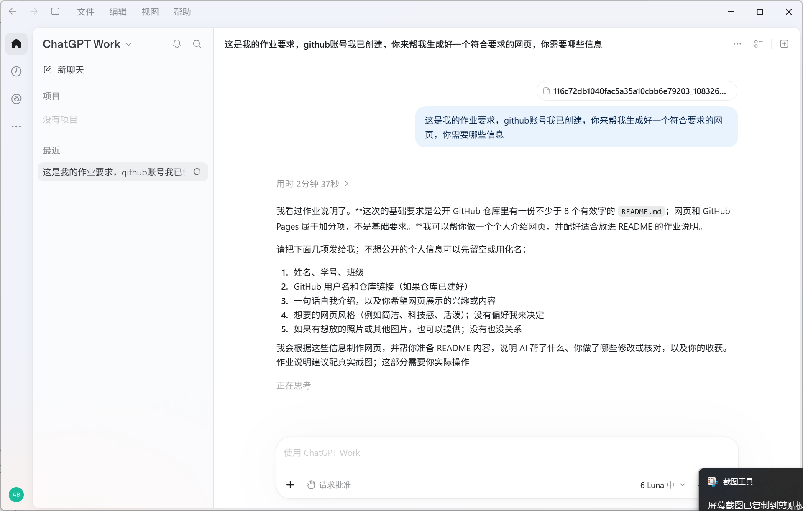

# 人工智能概论 · 第 1 次作业

> 提交前请把下面的 `xx` 替换为自己的姓名、学号和班级，并补上你真实做过的修改与验证记录。不要删掉仓库里以前的作业内容；后续作业继续追加在本文件末尾。

  <h1>我的 AI 学习档案</h1>
  
把想法变成作品，在尝试中记录判断与收获。

## 个人信息

- 姓名 / 学号：xx / xx
- 班级：xx
- GitHub 用户名：abqus
- 仓库地址：https://github.com/abqus/--1
- GitHub Pages 预期地址：<https://abqus.github.io/--1/>（启用 Pages 后确认可访问）

## 1. 任务

这次作业要完成 GitHub 仓库的初次提交，并用 README 记录我的学习过程。我还制作了一个科技感的个人介绍网页，介绍我如何使用 AI 工具辅助完成作业，以及我尝试编写网页对战游戏脚本的经历。

对我来说，这项作业不只是把文件放进仓库，也是在练习如何把一个想法整理成别人看得懂的成果：仓库要能找到，网页要能浏览，README 要能说明过程。以后课程中的其他作业也会继续放在这个仓库中，并按时间顺序追加记录。

## 2. 我做了什么

我先阅读作业说明，整理必须提交的个人信息和 README 内容，再制作个人介绍页。页面包含个人档案、项目记录、AI 协作说明和学习反思。我提供了本次作业背景，并附上梳理需求时的过程截图。

网页采用深色背景、蓝青色光效和卡片布局，内容分成个人档案、探索方向、脚本记录、过程反思几个部分。这样的结构让我可以先简要介绍自己，再展示正在做的事情，最后说明使用 AI 的方式和自己的收获。姓名、学号和班级目前用 `xx` 占位，提交前需要换成真实信息。

页面文件是 `index.html`，配图放在 `assets/ai-planning.png`。我准备使用 GitHub Pages 发布页面，让网页可以通过链接直接访问。启用后，可确认 <https://abqus.github.io/--1/> 是否能打开；若仓库设置生成了不同地址，应以 Pages 页面显示的地址为准。

## 3. 卡在哪 / 我的判断

我以为把网页做出来就完成了，后来发现作业还要求说明 AI 做了什么、我自己做了哪些核对，以及我从过程中学到了什么。原因是网页展示和过程记录分别对应不同的评分点，所以我把过程说明也补进了 README。

另一个需要注意的地方是，漂亮的页面不能代替真实的作业记录。页面展示结果，README 则说明任务、过程、分工和收获，两者需要互相对应。页面发布以后，我还要亲自打开链接检查显示是否正常，并确认仓库中图片路径没有写错。

## 4. 分工

WorkBuddy 和 ChatGPT 帮我梳理作业要求、组织 README 与网页初稿；DSH 协助编写 Pokémon Showdown 网页对战辅助脚本，内容涉及队伍解析、对战状态评估和行动选择。我负责提供作业背景和脚本目标、核对要求，并检查输出与页面内容。

从脚本结构看，它会读取队伍和对战数据，并根据当前局面评估可选行动。代码中包含队伍文本解析、属性相克计算、速度和伤害估算、首发选择、强制换人选择等逻辑；部分招式、特性、道具和天气也会参与判断。遇到使用率数据不可用时，脚本还会尝试使用简化的预测方式。这个项目让我看到，AI 辅助编程不仅是生成几行代码，也可以帮助把较大的问题拆成数据读取、状态分析和行动选择等小部分。

我会在提交前按照自己的实际操作补充两件事：我亲自修改了哪些内容，以及我怎样运行或核对脚本和网页。这样能清楚说明 AI 的帮助范围，也能让记录和实际过程一致。

## 5. 收获

我学到 AI 适合帮助我快速整理思路和形成初稿，但结果仍要自己核对。尤其是程序逻辑，不能只看代码写得完整，还要关注输入数据是否正确、特殊情况是否考虑，以及运行结果是否符合预期。

下一次我会边做边记录问题、修改原因和验证结果，而不是只在最后回忆过程。我也会先列出最小可完成版本，再逐步增加功能。这样既能更早发现问题，也能让 README 更准确地呈现我的过程和判断。

## 网页预览

打开仓库中的 `index.html` 查看网页源文件。启用 GitHub Pages 并确认网址可访问后，把上面的网页地址占位说明替换为实际站点链接。
